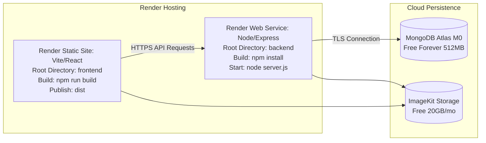
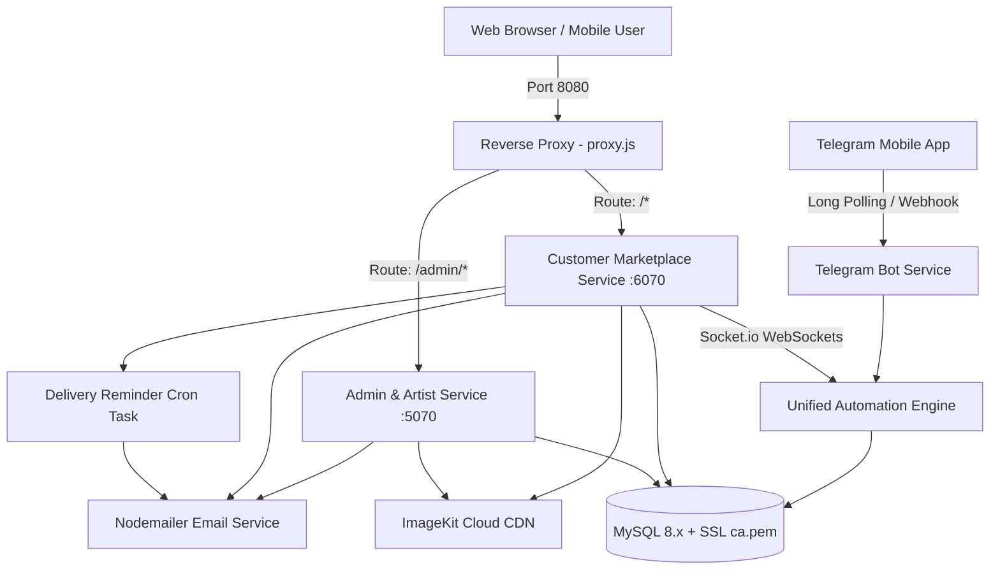
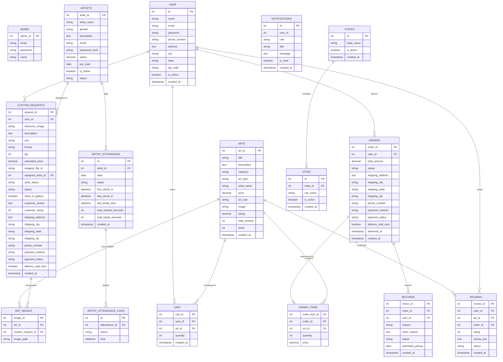

# 🎨 Fenaria Art Studio — Full-Stack Art E-Commerce & Studio Management Platform

[](https://nodejs.org/)
[](https://expressjs.com/)
[](https://www.mysql.com/)
[](https://socket.io/)
[](https://core.telegram.org/bots)
[](https://imagekit.io/)
[](https://opensource.org/licenses/ISC)

> **Fenaria Art Studio** is an enterprise-grade, full-stack art marketplace and studio management platform. It bridges art lovers with professional artists through curated art sales, custom commissioned artworks, real-time omnichannel conversational support (WebSockets + Telegram Bot), automated order delivery workflows, staff attendance tracking, and multi-tier operational management.

---

## 📑 Complete Table of Contents

- [🚀 MERN Modernization Scope of Work (SOW) & Target Architecture](#-mern-modernization-scope-of-work-sow--target-architecture)
- [🌐 Free-Tier Deployment & Hosting Blueprint (Render & MongoDB Atlas)](#-free-tier-deployment--hosting-blueprint-render--mongodb-atlas)
- [🌟 Comprehensive System Highlights](#-comprehensive-system-highlights)
- [🏛️ System Architecture & Microservice Topology](#️-system-architecture--microservice-topology)
- [💻 Deep-Dive Technology Stack](#-deep-dive-technology-stack)
- [📂 Full Project Directory & File Tree](#-full-project-directory--file-tree)
- [🗄️ Database Schema & Entity Relationship Overview](#️-database-schema--entity-relationship-overview)
- [📄 Complete Page-by-Page Inventory & Screen Functionality](#-complete-page-by-page-inventory--screen-functionality)
  - [🛍️ Customer Storefront Pages (13 Views & Partials)](#️-customer-storefront-pages-13-views--partials)
  - [👑 Admin & Artist Operations Pages (22 Views & Partials)](#-admin--artist-operations-pages-22-views--partials)
- [🎯 Complete Feature Matrix (Every Single Feature Documented)](#-complete-feature-matrix-every-single-feature-documented)
  - [1. Customer Experience & E-Commerce Storefront](#1-customer-experience--e-commerce-storefront)
  - [2. Custom Artwork Commissioning Pipeline](#2-custom-artwork-commissioning-pipeline)
  - [3. Happy Customers Public Exhibition Gallery](#3-happy-customers-public-exhibition-gallery)
  - [4. Dual-Channel AI Automation Bot (Web + Telegram)](#4-dual-channel-ai-automation-bot-web--telegram)
  - [5. Super Administrator Control Center](#5-super-administrator-control-center)
  - [6. Artist Workspace & Impersonation System](#6-artist-workspace--impersonation-system)
  - [7. Artist Workforce Attendance & Time Tracking](#7-artist-workforce-attendance--time-tracking)
  - [8. Automated Email Engine & Recurring Cron Jobs](#8-automated-email-engine--recurring-cron-jobs)
  - [9. Location & Delivery Serviceability Whitelist](#9-location--delivery-serviceability-whitelist)
  - [10. In-App Notifications & Alert Center](#10-in-app-notifications--alert-center)
- [🔌 Complete API & Endpoint Reference](#-complete-api--endpoint-reference)
  - [Customer & Public APIs](#customer--public-apis)
  - [Admin & Artist Management APIs](#admin--artist-management-apis)
- [⚙️ Environment Variables & Configuration](#️-environment-variables--configuration)
- [🛠️ Database Migration & Maintenance Utilities](#️-database-migration--maintenance-utilities)
- [🚀 Installation & Setup Guide](#-installation--setup-guide)
- [▶️ Running & Testing the Platform](#️-running--testing-the-platform)
- [👥 Contributing & License](#-contributing--license)

---

## 🚀 MERN Modernization Scope of Work (SOW) & Target Architecture

> **Notice**: The project is being transitioned from the legacy Express/EJS/MySQL architecture into a modern, decoupled **MERN Stack** (MongoDB Atlas + Express.js + React 18 / Vite + Node.js) with 100% free-tier cloud deployment feasibility.
> 
> The complete target directory blueprint is established in [`location_demo.ini`](file:///c:/Users/suran/Desktop/Fenaria/location_demo.ini).

### 🎯 Key Objectives & Deliverables
1. **Clean Decoupled Architecture**: Consolidate the existing multi-server setup (`admin/`, `user/`, `proxy.js`) into **two primary directories**:
   - `backend/`: Single Node.js + Express REST API & WebSocket server.
   - `frontend/`: Single React (Vite) Single Page Application (SPA).
2. **Database Migration to MongoDB Atlas**:
   - Replace 16 MySQL relational tables with scalable Mongoose models (`User`, `Staff`, `Art`, `ArtImage`, `Cart`, `Order`, `CustomRequest`, `Review`, `Attendance`, `AttendanceLog`, `Notification`, `Location`).
   - Eliminate complex table joins by embedding sub-documents (e.g., order items inside `Order`, attendance logs inside `Attendance`).
3. **Role-Based 3-Portal Client Architecture**:
   - **Customer Portal**: Storefront catalog, art details, shopping cart, checkout, tracking timeline, custom commission wizard, socket chat, and review submission.
   - **Shared Staff Authentication (`/staff/login`)**: Single login screen serving both Administrators and Artists, dynamically dispatching to their respective workspace upon authentication.
   - **Super Admin Portal (`/admin/*`)**: Complete inventory control, order fulfillment, return approvals, commission delegation, artist salary & workforce oversight, and review moderation.
   - **Artist Portal (`/artist/*`)**: Dedicated workbench for assigned commissions, time-tracking clock-in/out, live timer, break tracking, and personal analytics.
   - **Admin Impersonation**: Seamless 1-click token switch enabling super-admins to inspect the artist workspace as any artist without password entry.
4. **Preserved Integrations**:
   - Cloud media streaming via **ImageKit**.
   - Real-time customer chat via **Socket.io**.
   - Dual-channel bot via **Telegram Bot API** (`automationEngine.js`).
   - Transactional & 5-day delivery reminder emails via **Nodemailer** & cron.
5. **Continuous Learning & Command Tracking Rule**:
   - Every terminal command run, dependency installed, and component added must be documented step-by-step with a concise description of its purpose in [`Fena_learning/LEARNING_LOG.md`](file:///c:/Users/suran/Desktop/Fenaria/Fena_learning/LEARNING_LOG.md).

---

### 📂 Target MERN Project Directory Blueprint (from `location_demo.ini`)

```
Fenaria/
├── Fena_learning/                       # 📚 Learning documentation & command logs
│   └── LEARNING_LOG.md                  # Step-by-step commands and package use notes
│
├── backend/                             # 🚀 Node.js + Express + MongoDB REST API
│   ├── package.json
│   ├── .env.example                     # Reference for MONGO_URI, JWT_SECRET, etc.
│   ├── server.js                        # Express bootstrap, Socket.io, Cron init
│   │
│   ├── config/
│   │   ├── db.js                        # Mongoose connection to MongoDB Atlas
│   │   ├── emailService.js              # Nodemailer email dispatcher
│   │   └── imagekit.js                  # ImageKit SDK configuration
│   │
│   ├── models/                          # 🗄️ MongoDB Schemas (replaces 16 MySQL tables)
│   │   ├── User.js                      # Customers (with address, is_online, role: 'customer')
│   │   ├── Staff.js                     # Admins & Artists (salary, bio, joinDate, role: 'admin'|'artist')
│   │   ├── Art.js                       # Art catalog with embedded specs, tags, stock
│   │   ├── ArtImage.js                  # Supplementary gallery images
│   │   ├── Cart.js                      # User shopping cart items
│   │   ├── Order.js                     # Orders with embedded items, delivery tracking, return ref
│   │   ├── CustomRequest.js             # Commissions (reference image, specs, assigned artist)
│   │   ├── Review.js                    # Verified reviews with moderation status
│   │   ├── Attendance.js                # Artist daily check-in, check-out, worked time, breaks, leave
│   │   ├── AttendanceLog.js             # Detailed check-in/break time events
│   │   ├── Notification.js              # System notifications for staff & users
│   │   └── Location.js                  # Whitelisted states & cities
│   │
│   ├── controllers/                     # ⚙️ Request handlers & business logic
│   │   ├── authController.js            # Customer register/login + Staff login & impersonation
│   │   ├── artController.js             # Catalog CRUD, filters, stock updates
│   │   ├── cartController.js            # Cart add/update/remove
│   │   ├── checkoutController.js        # Order creation, inventory deduction, confirmation email
│   │   ├── orderController.js           # Order fulfillment, cancel, returns, delivery email
│   │   ├── customRequestController.js   # Commission delegation, artist status, gallery toggle
│   │   ├── reviewController.js          # Review submission & admin moderation
│   │   ├── attendanceController.js      # Clock-in, live timer, breaks, leave requests, daily/weekly stats
│   │   ├── staffController.js           # Artist CRUD, salary management, impersonate token
│   │   └── locationController.js        # State and city whitelist toggle
│   │
│   ├── middleware/
│   │   ├── authMiddleware.js            # JWT verification & extract user
│   │   ├── roleMiddleware.js            # Role guard: verifyAdmin, verifyArtist, verifyStaff
│   │   └── uploadMiddleware.js          # Multer memory storage for ImageKit
│   │
│   ├── routes/                          # 🔌 REST API Endpoints
│   │   ├── authRoutes.js                # /api/auth/*
│   │   ├── artRoutes.js                 # /api/arts/*
│   │   ├── cartRoutes.js                # /api/cart/*
│   │   ├── orderRoutes.js               # /api/orders/*
│   │   ├── customRequestRoutes.js       # /api/custom-requests/*
│   │   ├── reviewRoutes.js              # /api/reviews/*
│   │   ├── attendanceRoutes.js          # /api/attendance/*
│   │   ├── staffRoutes.js               # /api/staff/*
│   │   └── locationRoutes.js            # /api/locations/*
│   │
│   ├── services/
│   │   ├── automationEngine.js          # NLP engine (track orders, cancel, return, commissions)
│   │   └── telegramBot.js               # Telegram bot integration
│   │
│   └── utils/
│       └── deliveryReminderCron.js      # 6-hour cron for 5-day delivery reminders
│
│
├── frontend/                            # ⚛️ React 18+ Single Page App (Vite)
│   ├── package.json
│   ├── vite.config.js
│   ├── index.html
│   ├── .env.example                     # VITE_API_URL=http://localhost:5000/api
│   │
│   └── src/
│       ├── main.jsx                     # React DOM root & Providers
│       ├── App.jsx                      # Router & Route guards
│       ├── index.css                    # Global design tokens, animations, themes
│       │
│       ├── api/                         # Axios client with automatic JWT token attachment
│       │   └── axiosClient.js
│       │
│       ├── context/                     # Global State (Auth, Cart, Socket)
│       │   ├── AuthContext.jsx          # Login, Logout, Current User & Role
│       │   ├── CartContext.jsx          # Live cart count, items, subtotal
│       │   └── SocketContext.jsx        # Real-time WebSockets connection
│       │
│       ├── components/                  # Shared Reusable UI Components
│       │   ├── common/                  # Navbar, Footer, Modal, SkeletonLoader, Badge, Button
│       │   ├── chat/                    # Floating Socket.io Chat Widget with quick buttons
│       │   └── guards/                  # ProtectedRoute (Customer), AdminRoute, ArtistRoute
│       │
│       └── pages/                       # 📄 The 3 Portals (Lazy Loaded for fast load)
│           │
│           ├── customer/                # 🛍️ 1. Customer Storefront
│           │   ├── Home.jsx             # Catalog with category & type filters, recommendations
│           │   ├── ArtDetails.jsx       # Multi-image preview, specs, reviews, stock counter
│           │   ├── ArtistsDirectory.jsx # Resident artists showcase
│           │   ├── HappyCustomers.jsx   # Public commission gallery
│           │   ├── Cart.jsx             # Cart quantity editor & subtotal
│           │   ├── Checkout.jsx         # Address autofill, location whitelist, COD/Online
│           │   ├── CheckoutSuccess.jsx  # Order confirmed splash screen
│           │   ├── Orders.jsx           # Order tracking timeline, cancel & return modals
│           │   ├── CustomArt.jsx        # Commission wizard with live price calculation
│           │   ├── Login.jsx            # Customer Sign In
│           │   └── Register.jsx         # Customer Sign Up
│           │
│           ├── staff/                   # 🔐 2. Shared Staff Authentication
│           │   └── StaffLogin.jsx       # Unified Admin & Artist login with auto-role redirect
│           │
│           ├── admin/                   # 👑 3. Super Admin Portal
│           │   ├── AdminDashboard.jsx   # Metric charts, temporal filters, live order alert
│           │   ├── ArtManagement.jsx    # Art catalog CRUD, stock warnings, image upload
│           │   ├── OrderFulfillment.jsx # Status tracker, delivery mail trigger, details modal
│           │   ├── CustomRequests.jsx   # Commission delegation & exhibition gallery toggle
│           │   ├── ReturnRequests.jsx   # Return resolution & pickup scheduler
│           │   ├── ReviewModeration.jsx # Quarantine & approval toggle
│           │   ├── StaffManagement.jsx  # Artist onboarding, salaries, "Login-as Artist"
│           │   ├── AttendanceRoster.jsx # Real-time staff presence & manual status overrides
│           │   └── LocationManager.jsx  # State & City serviceability toggles
│           │
│           └── artist/                  # 🧑‍🎨 4. Artist Dedicated Portal
│               ├── ArtistDashboard.jsx  # Personal assigned tasks, stats, reviews
│               ├── TimeAttendance.jsx   # Clock-in, live timer, break pause/resume, leave form
│               ├── MyCommissions.jsx    # Assigned custom art workbench (In Progress/Done)
│               └── ArtistProfile.jsx    # Bio, medium, portfolio update
│
├── location_demo.ini                    # 📌 Target Blueprint Reference File
└── README.md                            # Complete Project Documentation
```

---

## 🌐 Free-Tier Deployment & Hosting Blueprint (Render & MongoDB Atlas)

### Will this folder structure cause issues or break on Render?
**No, absolutely not! In fact, this is the official, recommended industry-standard setup for full-stack monorepos on Render.**

Here is the exact configuration to ensure zero breakages and zero cost:



### 1. Backend on Render (Free Web Service)
- **Root Directory**: `backend` *(Render navigates directly into `/backend`, isolating backend dependencies completely)*.
- **Build Command**: `npm install`
- **Start Command**: `node server.js`
- **Instance Type**: Free (750 hours/month).
- **Zero-Sleep Keep-Alive**: Free Web Services sleep after 15 minutes of inactivity. We set up a free 10-minute ping using [cron-job.org](https://cron-job.org) or [UptimeRobot](https://uptimerobot.com) to `/api/health`. This guarantees the server stays awake 24/7 so Socket.io chat and the Telegram Bot never miss an event.

### 2. Frontend on Render (Free Static Site)
- **Root Directory**: `frontend` *(Render navigates directly into `/frontend`)*.
- **Build Command**: `npm run build`
- **Publish Directory**: `dist`
- **Redirects/Rewrites**: Add a Rewrite Rule: `/*` ➔ `/index.html` (Status: `200`) so React Router handles all sub-paths without 404 errors.
- **Cost**: 100% Free, unlimited bandwidth, backed by a global CDN, and **never sleeps**!

### 3. Database on MongoDB Atlas (Free M0 Cluster)
- **Tier**: M0 Sandbox (512 MB storage, shared RAM, free forever).
- **Network Access**: Add `0.0.0.0/0` (Allow Access from Anywhere) to permit Render's dynamic IP addresses.
- **Connection String**: Added as `MONGO_URI` environment variable in the backend Render dashboard.

---

## 🌟 Comprehensive System Highlights

- **Three-Tier Micro-Monolith Architecture**: Coordinated by an Express reverse proxy (`proxy.js` on port `8080`), seamlessly multiplexing traffic between the Admin Portal (`:5070`) and User Storefront (`:6070`).
- **End-to-End Commission Pipeline**: Full commission lifecycle—client reference upload, dimension and format selection, real-time automated pricing, administrative artist delegation, progress tracking, and public portfolio showcase.
- **Omnichannel Conversational AI Engine**: Single shared logic engine (`automationEngine.js`) powering both the on-site **Socket.io** customer widget and an external mobile **Telegram Bot**, handling order tracking, returns, cancellations, and commission tracking.
- **Precision Time & Attendance**: Studio artists log daily clock-in, break time, and clock-out with real-time browser counters, recording worked hours, pause intervals, half-days, and leave requests.
- **Impersonation System ("Login-As Artist")**: Super-admins can instantly impersonate any studio artist with a single click to audit their workspace without needing their passwords.
- **Automated Lifecycle Emails & Scheduled Cron Tasks**: Periodic background cron running every 6 hours to detect 5-day delivery milestones, alongside transactional triggers for order placement and delivery review prompts.
- **Location-Restricted Shipping**: Dynamic whitelist of states and cities managed from the admin panel, instantly restricting checkout and commissions to serviceable regions.

---

## 🏛️ System Architecture & Microservice Topology



### Port Allocation:
| Service | Internal Port | Public Proxy Port | Description |
|---|---|---|---|
| **Reverse Proxy** | `8080` | `http://localhost:8080` | Routes `/admin` to Admin App and `/` to User App |
| **Admin & Artist Service** | `5070` | `http://localhost:8080/admin` | Full back-office management, artist attendance, catalog CRUD |
| **User Marketplace** | `6070` | `http://localhost:8080/` | Storefront catalog, cart, checkout, socket chat, commissions |

---

## 💻 Deep-Dive Technology Stack

| Layer | Technologies | Key Packages & Versions |
|---|---|---|
| **Runtime & Core** | Node.js (v18+) | `express (v5.2.1)`, `dotenv (v17.4.2)`, `path`, `fs` |
| **Reverse Proxy** | Node HTTP Proxy | `http-proxy-middleware (v4.2.0)` |
| **Process Orchestration** | Concurrently | `concurrently (v10.0.3)` |
| **Database & Persistence** | MySQL 8.x + SSL | `mysql2 (v3.22.x)`, `express-mysql-session (v3.0.3)` |
| **Session Management** | Express Session | `express-session (v1.19.0)` (isolated sessions for Admin & User) |
| **Real-Time WebSockets** | Socket.io | `socket.io (v4.8.3)` |
| **Chatbot Integration** | Telegram Bot API | `node-telegram-bot-api (v1.1.2)` |
| **Cloud Storage & CDN** | ImageKit | `imagekit (v6.0.0)`, `multer (v2.2.0)` (Memory Storage) |
| **Email Delivery** | Nodemailer | `nodemailer (v9.0.3)` (Gmail SMTP / Custom SMTP / Ethereal Test) |
| **Security & Auth** | Bcrypt & SSL CA | `bcrypt (v6.0.0)`, `ca.pem` SSL certificate authority validation |
| **Frontend Templating** | EJS Templates | `ejs (v5.0.2)` |
| **Frontend Styling** | Vanilla CSS3 | Custom Responsive Layouts, Glassmorphism, CSS Loaders, Modals |
| **Client Scripting** | Vanilla JavaScript | Async Fetch API, WebSocket client, dynamic DOM, live counters |

---

## 📂 Full Project Directory & File Tree

```
Fenaria/
└── Art/
    ├── .gitignore                       # Git ignore list (node_modules, .env files, certificates)
    ├── ca.pem                           # SSL Certificate Authority file for Cloud MySQL
    ├── MySQL.sql                        # Base SQL schema for arts and art_images
    ├── package.json                     # Root orchestrator running admin, user & proxy
    ├── package-lock.json                # Root dependency lockfile
    ├── proxy.js                         # Reverse proxy gateway (Port 8080)
    │
    ├── admin/                           # 👑 Admin & Artist Operations Service (Port 5070)
    │   ├── app.js                       # Express bootstrap, session store, route mounting
    │   ├── package.json                 # Admin service dependencies
    │   ├── package-lock.json            # Admin dependency lockfile
    │   ├── server.log                   # Server output and diagnostic logs
    │   ├── ca.pem                       # SSL CA certificate copy for cloud database
    │   ├── test.js                      # Diagnostic attendance query test script
    │   ├── test2.js - test6.js          # Specific component and query testing scripts
    │   ├── update_db.js                 # Schema update script for custom_requests shipping fields
    │   ├── config/
    │   │   ├── db.js                    # SSL-configured MySQL connection pool
    │   │   ├── emailService.js          # Admin transactional delivery mail dispatcher
    │   │   └── imagekit.js              # ImageKit SDK credentials and uploader configuration
    │   ├── controllers/
    │   │   ├── adminController.js       # Admin authentication & dashboard metric stats
    │   │   ├── artController.js         # Art catalog CRUD operations
    │   │   ├── artImageController.js    # Multi-image upload and gallery associations
    │   │   ├── artistController.js      # Artist onboarding, profiles, and login-as
    │   │   ├── attendanceController.js  # Clock-in, break tracking, and leave requests
    │   │   ├── authController.js        # Admin login/logout handlers
    │   │   ├── customRequestController.js# Commission assignment, status & gallery exhibition
    │   │   ├── locationController.js    # State and city shipping serviceability
    │   │   ├── notificationController.js# Operational alerts and unread counts
    │   │   ├── orderController.js       # Order status tracking & delivery email trigger
    │   │   ├── returnController.js      # Return approval, rejection, and pickup dates
    │   │   └── reviewController.js      # Customer review moderation and approval
    │   ├── middleware/
    │   │   └── auth.js                  # Session verification middleware for admin/artist
    │   ├── models/
    │   │   ├── adminModel.js            # Admin analytics, queries & time filters
    │   │   ├── artImageModel.js         # Multi-image artwork associations
    │   │   ├── artModel.js              # Art piece queries, updates, and stock checks
    │   │   ├── artistModel.js           # Artist database operations and profile management
    │   │   ├── attendanceModel.js       # Check-in, check-out, break and leave queries
    │   │   ├── notificationModel.js     # Notification records and unread tracking
    │   │   └── orderModel.js            # Order queries, live polling, item aggregations
    │   ├── public/                      # Admin stylesheets, JavaScript, icons, and assets
    │   ├── routes/
    │   │   ├── adminRoutes.js           # All admin and artist routes
    │   │   └── upload.js                # Direct image upload endpoint
    │   ├── scratch/
    │   │   ├── create_location_tables.js# Migration script for states and cities tables
    │   │   ├── update_customArt_ejs.py  # Automation helper for view templating
    │   │   └── update_customArt_ejs2.py # Secondary templating utility
    │   └── views/                       # EJS UI templates
    │       ├── art/                     # Add, edit, and view art forms
    │       ├── artImage/                # Multiple art image upload & management
    │       ├── artist/                  # Artist registration and profile management
    │       ├── partials/                # Header, sidebar, and footer partials
    │       ├── attendance.ejs           # Attendance tracking and live clock dashboard
    │       ├── cities.ejs               # City serviceability manager
    │       ├── customRequests.ejs       # Commission management & assignment table
    │       ├── dashboard.ejs            # Analytics, revenue, and order metrics
    │       ├── login.ejs                # Admin & artist authentication screen
    │       ├── orders.ejs               # Order fulfillment and status timeline
    │       ├── profile.ejs              # Artist & admin profile details
    │       ├── returns.ejs              # Return request resolution dashboard
    │       ├── reviews.ejs              # Customer review moderation table
    │       └── states.ejs               # State delivery configuration
    │
    ├── user/                            # 🛍️ Customer Marketplace Service (Port 6070)
    │   ├── app.js                       # Express bootstrap, Socket.io, Cron init, Telegram init
    │   ├── package.json                 # User service dependencies
    │   ├── package-lock.json            # User dependency lockfile
    │   ├── server.log                   # Runtime logs and connection outputs
    │   ├── setup_returns.js             # Migration script for the `returns` table
    │   ├── config/
    │   │   ├── db.js                    # MySQL connection configuration with SSL
    │   │   ├── emailService.js          # Customer confirmation & reminder mail templates
    │   │   └── imagekit.js              # ImageKit configuration for user uploads
    │   ├── controller/
    │   │   ├── artController.js         # Art catalog browse, filter & details view
    │   │   ├── artistController.js      # Public artist directory
    │   │   ├── authController.js        # User signup, signin, online tracking, logout
    │   │   ├── automationEngine.js      # Central NLP conversational support engine
    │   │   ├── cartController.js        # Cart additions, quantity updates & removals
    │   │   ├── checkoutController.js    # Multi-step checkout & stock deduction
    │   │   ├── customArtController.js   # Custom art request submission & gallery view
    │   │   ├── orderController.js       # User order history, cancellation, and returns
    │   │   └── reviewController.js      # User post-delivery review submissions
    │   ├── middleware/
    │   │   └── authMiddleware.js        # User session validation middleware
    │   ├── models/
    │   │   ├── artModel.js              # Public art catalog queries
    │   │   ├── artistModel.js           # Public artist profiles
    │   │   ├── authModel.js             # User credentials & online presence
    │   │   ├── cartModel.js             # Shopping cart persistence
    │   │   ├── checkoutModel.js         # Order generation & bulk item insertion
    │   │   ├── customArtModel.js        # Custom commissions & happy customer gallery
    │   │   ├── orderModel.js            # User order lookups & status timeline
    │   │   └── returnModel.js           # Return requests creation and tracking
    │   ├── public/                      # Storefront styles, client JS, and assets
    │   ├── routes/
    │   │   ├── artRoutes.js             # Art catalog API
    │   │   ├── artistRoutes.js          # Artists page route
    │   │   ├── authRoutes.js            # Customer authentication routes
    │   │   ├── cartRoutes.js            # Shopping cart management routes
    │   │   ├── checkoutRoutes.js        # Checkout and order placement routes
    │   │   ├── upload.js                # Customer image upload route
    │   │   └── userRoutes.js            # Customer orders, returns, reviews, custom art
    │   ├── services/
    │   │   └── telegramBot.js           # Telegram bot long-polling & message handler
    │   ├── utils/
    │   │   └── deliveryReminderCron.js  # Scheduled automated delivery reminder task
    │   └── views/                       # Customer EJS pages
    │       ├── partials/                # Storefront navigation bar & footer
    │       ├── artDetails.ejs           # Artwork details, dimensions, multi-image view
    │       ├── artists.ejs              # Featured artist showcase directory
    │       ├── cart.ejs                 # Interactive shopping cart
    │       ├── checkout.ejs             # Address validation & payment checkout
    │       ├── checkout-success.ejs     # Order success splash page
    │       ├── customArt.ejs            # Custom art commissioning wizard
    │       ├── happyCustomers.ejs       # Commissioned artwork exhibition gallery
    │       ├── home.ejs                 # Homepage art catalog with filters & loaders
    │       ├── orders.ejs               # Order tracking, returns & cancellation hub
    │       ├── signin.ejs               # Customer signin
    │       └── signup.ejs               # Customer signup
    │
    ├── my arts 🎨/                      # 🖼️ High-resolution catalog of 108 original photos/videos
    ├── uploads/                         # Shared local disk upload storage (arts/ and general)
    └── scratch/                         # Developer scratch files (customArt_script.js, etc.)
```

---

## 🗄️ Database Architecture & Schema

The platform relies on a normalized MySQL database featuring 16 interconnected tables:



---

## 📄 Complete Page-by-Page Inventory & Screen Functionality

Every individual view and partial file in the repository is inventoried below with its URL route, template path, and exact capabilities:

### 🛍️ Customer Storefront Pages (13 Views & Partials)

| # | Page / Template | URL Route | Key Capabilities & Functionality |
|:---:|---|---|---|
| **1** | `user/views/home.ejs` | `/user/home` or `/` | • Main artwork catalog with responsive grid<br>• Dynamic category filters (Paintings, Sketches, etc.)<br>• Art type filtering (Oil, Acrylic, Charcoal)<br>• Animated card skeleton loaders during fetch<br>• Random art recommendations carousel<br>• Direct "Add to Cart" and "Added" button toggles |
| **2** | `user/views/artDetails.ejs` | `/user/art/:id` | • Multi-angle image previewer with high-res thumbnails<br>• Complete artwork specs (medium, size, dimensions)<br>• Dynamic stock availability badge<br>• Verified customer reviews list with star distribution<br>• Artist attribution card with link to artist profile |
| **3** | `user/views/artists.ejs` | `/user/artists` | • Directory of resident artists and bios<br>• Displays artist experience, join dates, and artistic medium<br>• Direct links to browse artwork created by specific artist |
| **4** | `user/views/happyCustomers.ejs` | `/happy-customers` | • Public showcase gallery of fulfilled custom commissions<br>• Displays customer testimonial, requested specs, and artist credit<br>• Studio-uploaded completed artwork photography |
| **5** | `user/views/cart.ejs` | `/user/cart` | • Persistent user cart item list with thumbnail previews<br>• In-line quantity adjustment buttons (`+` and `-`)<br>• Individual item deletion<br>• Real-time price, subtotal, and estimated total calculation<br>• Direct proceed to checkout button |
| **6** | `user/views/checkout.ejs` | `/user/checkout` | • Order summary and price breakdown<br>• Autofilled shipping address from user account<br>• Dynamic State & City select menus (whitelisted via `/api/locations`)<br>• Payment method selection (Cash on Delivery / Online)<br>• Deducts inventory upon order placement |
| **7** | `user/views/checkout-success.ejs` | `/user/checkout/success` | • Order confirmation splash screen with unique order code (`ORD-XXXX`)<br>• Estimated delivery timeline notice<br>• Direct link to view order history |
| **8** | `user/views/orders.ejs` | `/user/orders` | • Comprehensive order history with status badges<br>• Interactive 5-stage progress tracking timeline<br>• One-click order cancellation for unfulfilled orders<br>• Return request trigger modal with reason dropdown and comments |
| **9** | `user/views/customArt.ejs` | `/user/custom-art` | • Interactive custom art commission wizard<br>• Image upload with live client-side preview<br>• Dimension selector (Small, Medium, Large, Custom dimensions)<br>• Art format selector (Oil, Acrylic, Watercolor, Sketch, Canvas)<br>• Dynamic real-time pricing calculator based on size & medium<br>• Delivery address and contact input fields |
| **10** | `user/views/signin.ejs` | `/user/signin` | • Customer login with email and password<br>• Automatic update of `is_online = 1`<br>• Link to registration page and password reset |
| **11** | `user/views/signup.ejs` | `/user/signup` | • Customer account creation<br>• Name, email, password hashing via bcrypt<br>• Delivery address, phone number, city, state, zip code fields |
| **12** | `user/views/partials/navbar.ejs` | Global User Partial | • Responsive header bar with brand identity<br>• Dynamic live cart count badge (updated via `/api/cart/count`)<br>• User profile dropdown & logout trigger<br>• Links to Catalog, Artists, Custom Art, Happy Customers, Orders |
| **13** | `user/views/partials/footer.ejs` | Global User Partial | • Brand footer with copyright, links, and customer support info<br>• **Socket.io** floating real-time chat widget integration<br>• Post-delivery pending review modal popup script (`/api/user/reviews/pending`) |

---

### 👑 Admin & Artist Operations Pages (22 Views & Partials)

| # | Page / Template | URL Route | Key Capabilities & Functionality |
|:---:|---|---|---|
| **1** | `admin/views/login.ejs` | `/admin` | • Administrative and artist portal login<br>• Role-based authentication redirecting to custom dashboard |
| **2** | `admin/views/dashboard.ejs` | `/admin/dashboard` | • Comprehensive operations analytics center<br>• Temporal filters: `Today`, `Last 7 Days`, `This Month`, `All Time`<br>• Real-time revenue, order counts, pending shipments, delivered metrics<br>• Inventory out-of-stock count and customer reviews count<br>• Tailored artist-specific metrics when logged in as an artist |
| **3** | `admin/views/profile.ejs` | `/admin/profile` | • Admin & artist profile management<br>• View and update name, email, biography, and password |
| **4** | `admin/views/attendance.ejs` | `/admin/attendance` | • Interactive time-clock console for studio artists<br>• 1-click **Check-In** with real-time live digital timer<br>• **Pause / Resume** break interval tracking<br>• **Check-Out** work duration calculation & status classification (`Present`/`Half Day`)<br>• Leave request form (Full Day / Half Day)<br>• Administrative live studio roster showing who is working, on break, or absent<br>• Weekly artist attendance history and administrative manual status overrides |
| **5** | `admin/views/orders.ejs` | `/admin/orders/view` | • Master order fulfillment table with customer contact details<br>• Live order polling (`checkNewOrdersAPI`) for instant incoming order alerts<br>• Order item inspection modal with dimensions and image previews<br>• Status update dropdown (`Pending` ➔ `Processing` ➔ `Shipped` ➔ `Delivered` ➔ `Cancelled`)<br>• Setting status to `Delivered` automatically dispatches delivery & review email |
| **6** | `admin/views/returns.ejs` | `/admin/returns/view` | • Customer return requests resolution center<br>• Review customer reasons (`Damaged`, `Wrong item`, `Other`) and explanations<br>• Approve or reject return requests<br>• Assign and schedule courier pickup date (`estimated_pickup`) |
| **7** | `admin/views/reviews.ejs` | `/admin/reviews/view` | • Customer review moderation queue<br>• Quarantine incoming customer reviews<br>• Single-click approval publishes review to product page and recalculates star ratings |
| **8** | `admin/views/customRequests.ejs` | `/admin/custom-requests/view` | • Master custom commission delegation table<br>• Inspect customer reference photos, dimensions, medium, and notes<br>• Assign commission to active studio artist from dropdown<br>• Update commission progress (`Pending` ➔ `Assigned` ➔ `In Progress` ➔ `Completed`)<br>• Toggle `show_in_gallery` flag to feature finished work on `/happy-customers` |
| **9** | `admin/views/states.ejs` | `/admin/locations/states` | • Manage delivery serviceable states<br>• Add new states<br>• Toggle state active/inactive status<br>• Delete state (cascades to linked cities) |
| **10** | `admin/views/cities.ejs` | `/admin/locations/cities` | • Manage delivery serviceable cities linked to specific states<br>• Add new cities under selected state<br>• Toggle city active/inactive status<br>• Delete city record |
| **11** | `admin/views/art/viewArt.ejs` | `/admin/art/view` | • Complete artwork inventory table<br>• Stock count display with zero-stock warning badges<br>• Filter by artist, category, or title<br>• Delete and edit actions |
| **12** | `admin/views/art/addArt.ejs` | `/admin/art/add` | • Add new artwork form<br>• Fields for title, description, category, art type, artist name, price, size, and stock count |
| **13** | `admin/views/art/editArt.ejs` | `/admin/art/edit/:id` | • Edit existing artwork form<br>• Modify pricing, description, stock, and dimensions |
| **14** | `admin/views/artImage/viewArtImage.ejs`| `/admin/art-image/view` | • Supplementary artwork image gallery table<br>• Shows linked artwork titles and image thumbnails<br>• Delete supplementary image action |
| **15** | `admin/views/artImage/addArtImage.ejs` | `/admin/art-image/add` | • Multi-image upload form for artworks or custom commissions<br>• Memory storage streaming directly to ImageKit CDN |
| **16** | `admin/views/artImage/editArtImage.ejs`| `/admin/art-image/edit/:id` | • Replace or modify supplementary artwork image record |
| **17** | `admin/views/artist/viewArtist.ejs` | `/admin/artist/view` | • Master artist directory table<br>• View artist name, email, salary, join date, and active status<br>• **Login as Artist** button for 1-click super-admin impersonation without password |
| **18** | `admin/views/artist/addArtist.ejs` | `/admin/artist/add` | • New artist onboarding form<br>• Name, gender, bio, email, password, salary, and join date fields |
| **19** | `admin/views/artist/editArtist.ejs` | `/admin/artist/edit/:id` | • Edit artist details, update salary, bio, or credentials |
| **20** | `admin/views/partials/header.ejs` | Global Admin Partial | • Top navigation bar with user profile info<br>• In-app notification center bell with unread badge counter<br>• Direct profile link and logout button |
| **21** | `admin/views/partials/sidebar.ejs` | Global Admin Partial | • Dynamic role-based navigation bar<br>• Displays Admin vs Artist navigation links based on session role<br>• Links to Dashboard, Attendance, Artists, Art, Images, Orders, Returns, Reviews, Custom Requests, States, and Cities |
| **22** | `admin/views/partials/footer.ejs` | Global Admin Partial | • Admin script dependencies, modal handlers, and live polling initialization |

---

## 🎯 Complete Feature Matrix (Every Single Feature Documented)

### 1. Customer Experience & E-Commerce Storefront
- **Dynamic Catalog & Search**:
  - Live category filter (e.g. Canvas, Sketches, Acrylic, Oil).
  - Artwork type filter (Portrait, Landscape, Abstract, Modern).
  - Animated skeleton loading states on artwork cards while content loads.
  - Random art card suggestion section to discover new artists.
- **Artwork Detail Page**:
  - Multi-image gallery with high-res thumbnail switcher.
  - Detailed dimension specs, category badge, and medium info.
  - Live stock counter showing real-time inventory.
  - Artist profile card linking to the creator's full catalog.
  - Verified customer reviews list with star rating breakdown.
- **Cart Management**:
  - Add-to-cart with duplicate handling (automatically increments quantity if item is already in cart).
  - Dynamic quantity modification directly within the cart view.
  - Live subtotal and tax calculation.
  - Dynamic navbar cart badge updated via `/api/cart/count`.
  - Product cards dynamically reflect `"Added to Cart"` state via `/api/cart/items`.
- **Checkout & Inventory Guarantee**:
  - Autofill shipping details from user profile with live inline edit.
  - Strict geographic validation (State and City select menus query `/api/locations` and only show active delivery zones).
  - Cash on Delivery (COD) and payment method selections.
  - Atomic stock deduction: automatically decrements stock in `arts` table upon checkout.
  - Automatic cart clearing upon successful purchase.
  - Immediate trigger of transactional **Order Confirmation Email**.
- **Customer Order Hub & Visual Timeline**:
  - Historical order list with pricing, item cards, and order IDs (`ORD-XXXX`).
  - Visual 5-stage tracking timeline: `Pending` ➔ `Processing` ➔ `Shipped` ➔ `Delivered` ➔ `Cancelled`.
  - One-click order cancellation available for unfulfilled orders.
- **Order Returns & Pickup Management**:
  - Dedicated return request modal.
  - Predefined reason selection (`Damaged in transit`, `Wrong item received`, `Quality does not match`, `Other`).
  - Custom explanation textarea when `Other` is selected.
  - Tracking of return status (`Pending`, `Approved`, `Rejected`) and scheduled pickup date.
- **Automated Post-Delivery Review Modal**:
  - On login or orders view, the app calls `/api/user/reviews/pending`.
  - If any standard order or custom art request was marked `Delivered` without a review, a modal automatically prompts the user for a 1–5 star rating and feedback.
- **Online Presence Tracking**:
  - Sets `is_online = 1` in `user` table on login.
  - Sets `is_online = 0` on logout.
  - Startup safety cleanup: server reset clears stuck online sessions on reboot (`UPDATE user SET is_online = 0`).

---

### 2. Custom Artwork Commissioning Pipeline
- **Commission Submission Wizard**:
  - Image upload with live client-side image preview before submission.
  - Upload handled via Multer Memory Storage directly to ImageKit CDN (`imagekit_file_id` stored for cloud reference).
  - Dimension selection (Small, Medium, Large, Custom dimensions).
  - Art format selector (Oil Painting, Acrylic, Watercolor, Pencil Sketch, Framed Canvas).
  - Quantity counter.
  - Real-time dynamic price estimator calculating quote based on size, medium, and quantity.
  - Complete shipping address, contact phone, and payment method collection.
- **Order Lifecycle & Tracking**:
  - Generates custom request ID (`REQ-XXXX`).
  - Appears in customer order hub with live status updates.
  - Trigger for transactional commission confirmation email.

---

### 3. Happy Customers Public Exhibition Gallery
- Accessible publicly at `/happy-customers`.
- Displays completed custom commissions where `show_in_gallery = 1`.
- Highlights customer testimonials, requested specifications, and artist attribution.
- Showcases finished artwork photography uploaded by studio administrators via `art_images` associations.

---

### 4. Dual-Channel AI Automation Bot (Web + Telegram)
- **Central Intelligence Engine (`automationEngine.js`)**:
  - Single, channel-agnostic logic engine shared between web and mobile bots.
  - Natural Language Processing (NLP) pattern matching for user inquiries.
- **Interactive Web Chat**:
  - Integrated on every customer page using **Socket.io**.
  - Interactive quick-reply buttons and message histories.
- **Telegram Bot Integration (`@bot`)**:
  - Built with `node-telegram-bot-api` in long-polling mode.
  - Dynamic `inline_keyboard` buttons corresponding to engine options.
  - Handles `ForceReply` prompts to collect text input for returns and complaints.
- **Supported Chatbot Workflows**:
  - **Track Standard Order**: Enter `ORD-XXXX` or plain numbers to receive instant real-time status and delivery dates.
  - **Track Custom Commission**: Enter `REQ-XXXX` or choose from recent requests.
  - **Order Cancellation**: Validates eligibility and cancels unfulfilled orders directly in chat.
  - **Return Assistance**: Guides customer through return reasons and logs tickets.

---

### 5. Super Administrator Control Center
- **Comprehensive Analytics Dashboard**:
  - Temporal filtering: `Today`, `Last 7 Days`, `This Month`, `All Time`.
  - Real-time stats: Total revenue, order count, pending shipments, delivered orders, out-of-stock items, total arts, and customer review metrics.
- **Real-Time Polling & Alerts (`checkNewOrdersAPI`)**:
  - Polling API alerts admin instantly of new orders without page refreshes.
  - Tracks cancelled order counts and zero-stock inventory warnings.
- **Art Catalog Management (Full CRUD)**:
  - Add, edit, and delete artwork records.
  - Pricing, description, category, art type, dimensions, and stock management.
  - Out-of-stock badge warning in admin tables when `stock <= 0`.
- **Multi-Image Artwork Media Uploader**:
  - Upload multiple supplementary photos per art piece.
  - Memory buffer streaming directly to ImageKit with CDN URLs stored in `art_images`.
- **Order Fulfillment Pipeline**:
  - View all customer orders with customer email, phone, and delivery address.
  - Status updates: `Pending` ➔ `Processing` ➔ `Shipped` ➔ `Delivered` ➔ `Cancelled`.
  - **Automatic Delivery Email Trigger**: Setting status to `Delivered` records `delivered_at` timestamp and triggers the **Order Delivered & Review Invitation Email** to the customer.
- **Custom Commission Delegation**:
  - Admin inspects incoming client reference images and specifications.
  - Assigns request to an active artist from a dynamic dropdown.
  - Updates overall delivery status and payment status.
  - Toggle `show_in_gallery` flag to feature finished work on `/happy-customers`.
- **Return Request Moderation**:
  - Inspect customer return reason and description.
  - Approve or reject return requests.
  - Assign `estimated_pickup` date for courier dispatch.
- **Customer Review Moderation Queue**:
  - New customer reviews remain quarantined until reviewed by admin.
  - Single-click approval publishes review to product page and recalculates aggregate rating score (`arts.rating`) and total review counter (`arts.total_reviews`).

---

### 6. Artist Workspace & Impersonation System
- **Role-Based Artist View**:
  - Artists log into `/admin` with their assigned credentials.
  - Custom artist dashboard showing only their assigned commissions, performance stats, and received reviews.
- **Super-Admin "Login-As" Feature**:
  - Administrators can click `"Login as Artist"` on any artist record.
  - Instantly assumes the artist's session without requiring their password (`loginAsArtistAPI`), allowing administrators to assist artists or verify workflow states.
- **Artist Commission Workbench**:
  - Artists view reference photos, customer notes, and specifications.
  - Update workflow state: `Assigned` ➔ `In Progress` ➔ `Completed`.
- **Artist Profile Self-Management**:
  - Artists can edit their bio, description, and update their password.

---

### 7. Artist Workforce Attendance & Time Tracking
- **Interactive Attendance Dashboard (`/admin/attendance`)**:
  - **Clock-In**: 1-click check-in records arrival time and logs `'Check In'` event.
  - **Live Digital Clock**: Real-time browser timer showing active seconds worked.
  - **Pause / Take Break**: Suspends active work timer and tracks break intervals (`'Break/Check Out'` logged in `artist_attendance_logs`).
  - **Resume Work**: Resumes work timer and calculates total break duration.
  - **Clock-Out**: Calculates total working seconds for the day and marks status (`Present` or `Half Day`).
  - **Request Leave**: Leave submission dialog with reason and duration (`Leave` or `Half Day`).
- **Administrative Attendance Oversight**:
  - Real-time studio roster showing who is currently Present, on Break, on Leave, or Absent.
  - Historical weekly attendance tables and exportable daily logs.
  - Administrative override to manually correct artist attendance statuses.

---

### 8. Automated Email Engine & Recurring Cron Jobs
- **Flexible SMTP Transport Configuration**:
  - Supports Gmail App Passwords, custom SMTP servers, or automatic Ethereal test accounts with terminal preview URLs.
- **Email Notification Workflows**:
  1. **Order Confirmation Email**: Dispatched immediately upon order or custom commission placement with order breakdown and estimated delivery.
  2. **Delivery Day Reminder Email**: Background cron scans database every 6 hours and dispatches friendly reminder emails on the expected delivery day (5 days post-creation).
  3. **Order Delivered & Review Invitation Email**: Dispatched when admin sets order to `Delivered`, providing a direct link for verified reviews.
- **Background Cron Implementation (`deliveryReminderCron.js`)**:
  - Starts 10 seconds after server boot, repeats every 6 hours (`setInterval`).
  - Scans both `orders` and `custom_requests` where status is not `Delivered`/`Cancelled` and `created_at` was 5 days ago.
  - Updates `delivery_mail_sent = 1` flag to prevent duplicate notifications.

---

### 9. Location & Delivery Serviceability Whitelist
- **State Management**:
  - Add new states.
  - Toggle state active/inactive status.
  - Deleting a state cascades to its linked cities.
- **City Management**:
  - Add cities linked to specific states.
  - Toggle city active/inactive status.
- **Client-Side Enforcement**:
  - Storefront checkout and custom art wizards fetch `/api/locations`.
  - Only active states and active cities are selectable, preventing orders to non-serviceable regions.

---

### 10. In-App Notifications & Alert Center
- Dedicated notifications table (`notifications`).
- Unread badge counter for administrators and artists.
- Alerts on new orders, custom requests, and workflow updates.
- Endpoints to mark individual notifications or all notifications as read.

---

## 🔌 Complete API & Endpoint Reference

### Customer & Public APIs
| Method | Route | Description | Auth Required |
|---|---|---|:---:|
| `GET` | `/user/home` | Public artwork catalog with filters & search | No |
| `GET` | `/user/art/:id` | Detailed art view with multi-image gallery & reviews | No |
| `GET` | `/user/artists` | Directory of studio artists | No |
| `GET` | `/happy-customers` | Public showcase of completed custom commissions | No |
| `GET` | `/api/locations` | Get active states and serviceable cities | No |
| `GET` | `/api/user/orders/track/:orderId`| Public tracking lookup for orders | No |
| `GET` | `/api/reviews/approved` | Get approved reviews for gallery showcase | No |
| `POST` | `/user/signup` | Customer account registration | No |
| `POST` | `/user/signin` | Customer authentication | No |
| `GET` | `/user/logout` | Terminate session & set `is_online = 0` | Yes |
| `GET` | `/user/cart` | View interactive cart page | Yes |
| `POST` | `/api/cart` | Add artwork to shopping cart (handles duplicates) | Yes |
| `PUT` | `/api/cart/:cartId/quantity` | Update item quantity in cart | Yes |
| `DELETE` | `/api/cart/:cartId` | Remove item from cart | Yes |
| `GET` | `/api/cart/count` | Get total item count in user's cart | Yes |
| `GET` | `/api/cart/items` | Get array of art IDs in user's cart | Yes |
| `GET` | `/user/checkout` | Checkout form with profile autofill | Yes |
| `POST` | `/api/checkout/process` | Process order, deduct stock, trigger mail | Yes |
| `GET` | `/user/checkout/success` | Order confirmation success screen | Yes |
| `GET` | `/user/orders` | Customer order history & tracking timeline | Yes |
| `PUT` | `/api/user/orders/:id/cancel` | Cancel eligible unfulfilled order | Yes |
| `POST` | `/api/orders/return` | Submit return request with reason | Yes |
| `GET` | `/user/custom-art` | Custom commission submission wizard | Yes |
| `POST` | `/api/custom-art/submit` | Upload reference image & submit commission | Yes |
| `GET` | `/api/user/reviews/pending` | Check for unreviewed delivered orders | Yes |
| `POST` | `/api/user/reviews/submit` | Submit star rating and review feedback | Yes |

---

### Admin & Artist Management APIs
| Method | Route | Description | Auth Required |
|---|---|---|:---:|
| `GET` | `/admin` | Admin & artist login view | No |
| `POST` | `/admin/login` | Authenticate admin or artist credentials | No |
| `GET` | `/admin/logout` | Terminate administrative session | Yes |
| `GET` | `/admin/dashboard` | Main operations dashboard | Admin/Artist |
| `GET` | `/admin/api/dashboard/stats` | Analytics metrics (filtered by today/week/month/all) | Admin/Artist |
| `GET` | `/admin/profile` | View admin or artist profile | Admin/Artist |
| `PUT` | `/admin/api/profile/update` | Update profile information | Admin/Artist |
| `GET` | `/admin/attendance` | Attendance management & clock-in view | Admin/Artist |
| `POST` | `/admin/api/attendance/check-in` | Artist shift check-in | Artist |
| `POST` | `/admin/api/attendance/check-out` | Artist shift check-out | Artist |
| `POST` | `/admin/api/attendance/leave` | Submit leave request (Full/Half Day) | Artist |
| `GET` | `/admin/api/attendance/live-status` | Get current active timer seconds | Artist |
| `GET` | `/admin/api/attendance/weekly` | Get artist weekly attendance history | Artist |
| `GET` | `/admin/api/attendance/daily` | Get daily attendance roster for all artists | Admin |
| `PUT` | `/admin/api/attendance/update-status`| Administrative attendance status override | Admin |
| `GET` | `/admin/artist/view` | Artist roster table | Admin |
| `GET` | `/admin/artist/add` | New artist onboarding form | Admin |
| `POST` | `/admin/api/artist/add` | Create new artist record | Admin |
| `GET` | `/admin/artist/edit/:id` | Edit artist profile form | Admin |
| `PUT` | `/admin/api/artist/update/:id` | Update artist details or salary | Admin |
| `DELETE` | `/admin/api/artist/delete/:id` | Delete artist record | Admin |
| `POST` | `/admin/api/artist/login-as/:id`| Impersonate artist without password | Admin |
| `GET` | `/admin/art/view` | Art catalog management table | Admin |
| `GET` | `/admin/art/add` | Add artwork form | Admin |
| `POST` | `/admin/api/art/add` | Create new artwork record | Admin |
| `GET` | `/admin/art/edit/:id` | Edit artwork form | Admin |
| `PUT` | `/admin/api/art/update/:id` | Update artwork details or stock count | Admin |
| `DELETE` | `/admin/api/art/delete/:id` | Delete artwork record | Admin |
| `GET` | `/admin/art-image/add` | Supplementary artwork image uploader | Admin |
| `POST` | `/admin/api/art-image/add` | Upload images via ImageKit CDN | Admin |
| `GET` | `/admin/art-image/view` | Art images gallery table | Admin |
| `DELETE` | `/admin/api/art-image/delete/:id`| Delete supplementary art image | Admin |
| `GET` | `/admin/orders/view` | Order fulfillment table | Admin |
| `GET` | `/admin/api/orders/check-new` | Live order polling (detects new/cancelled/out-of-stock)| Admin |
| `GET` | `/admin/api/orders/:id/items` | Get detailed item breakdown for order | Admin |
| `PUT` | `/admin/api/orders/update/:id` | Update order status (`Delivered` triggers mail) | Admin |
| `GET` | `/admin/returns/view` | Return requests management | Admin |
| `GET` | `/admin/api/returns/check-new` | Poll for newly submitted return requests | Admin |
| `PUT` | `/admin/api/returns/update-status/:id`| Approve/reject return & schedule pickup | Admin |
| `GET` | `/admin/reviews/view` | Customer reviews moderation table | Admin |
| `GET` | `/admin/api/reviews/check-new` | Poll for newly submitted customer reviews | Admin |
| `PUT` | `/admin/api/reviews/approve/:id` | Approve review & recalculate ratings | Admin |
| `GET` | `/admin/custom-requests/view` | Commission management table | Admin/Artist |
| `GET` | `/admin/api/custom-requests/check-new`| Poll for new custom commission requests | Admin |
| `PUT` | `/admin/api/custom-requests/assign/:id`| Assign commission to artist | Admin |
| `PUT` | `/admin/api/custom-requests/update-status/:id`| Update commission delivery status | Admin |
| `PUT` | `/admin/api/custom-requests/update-artist-status/:id`| Artist updates progress | Artist |
| `PUT` | `/admin/api/custom-requests/toggle-gallery/:id`| Toggle public exhibition on `/happy-customers`| Admin |
| `GET` | `/admin/api/notifications` | Get unread notification list | Admin/Artist |
| `POST` | `/admin/api/notifications/mark-read/:id`| Mark single notification as read | Admin/Artist |
| `POST` | `/admin/api/notifications/mark-all-read`| Mark all notifications as read | Admin/Artist |
| `GET` | `/admin/locations/states` | State delivery management view | Admin |
| `POST` | `/admin/api/locations/states/add`| Add new serviceable state | Admin |
| `PUT` | `/admin/api/locations/states/toggle/:id`| Toggle state active/inactive status | Admin |
| `DELETE` | `/admin/api/locations/states/:id`| Delete state and associated cities | Admin |
| `GET` | `/admin/locations/cities` | City delivery management view | Admin |
| `POST` | `/admin/api/locations/cities/add`| Add new serviceable city | Admin |
| `PUT` | `/admin/api/locations/cities/toggle/:id`| Toggle city active/inactive status | Admin |
| `DELETE` | `/admin/api/locations/cities/:id`| Delete city record | Admin |

---

## ⚙️ Environment Variables & Configuration

Create `.env` configuration files in both `Art/admin/` and `Art/user/` directories, or define them in your environment:

```env
# Server Port Configuration (Proxy defaults to 8080)
PORT=8080

# MySQL Database Connection
DB_HOST=your-mysql-host.example.com
DB_PORT=3306
DB_USER=your_db_username
DB_PASSWORD=your_db_password
DB_NAME=your_database_name

# Email Delivery Configuration (Nodemailer)
SMTP_HOST=smtp.gmail.com
SMTP_PORT=587
SMTP_SECURE=false
EMAIL_USER=your-email@gmail.com
EMAIL_PASS=your-app-specific-password

# ImageKit Cloud CDN Storage
IMAGEKIT_PUBLIC_KEY=your_imagekit_public_key
IMAGEKIT_PRIVATE_KEY=your_imagekit_private_key
IMAGEKIT_URL_ENDPOINT=https://ik.imagekit.io/your_endpoint_id

# Telegram Bot (Optional - for mobile chatbot integration)
TELEGRAM_BOT_TOKEN=your_telegram_bot_token
```

> **Cloud Database SSL Note**: When using cloud MySQL hosts (such as Aiven, PlanetScale, or AWS RDS), place your valid `ca.pem` certificate in the `Art/` root directory. The application reads `ca.pem` automatically.

---

## 🛠️ Database Migration & Maintenance Utilities

The project includes purpose-built migration and diagnostic scripts:

| Script | Location | Purpose |
|---|---|---|
| `MySQL.sql` | `Art/MySQL.sql` | Initial table creation for `arts` and `art_images` |
| `setup_returns.js` | `Art/user/setup_returns.js` | Creates the `returns` table schema |
| `update_db.js` | `Art/admin/update_db.js` | Adds address, phone, and payment fields to `custom_requests` |
| `create_location_tables.js` | `Art/admin/scratch/create_location_tables.js` | Creates `states` and `cities` tables with foreign keys |
| `test.js` | `Art/admin/test.js` | Diagnostic script for checking attendance statistics queries |

---

## 🚀 Installation & Setup Guide

### 1. Clone the Repository
```bash
git clone https://github.com/fena-surani01/Art.git
cd Art
```

### 2. Install Project Dependencies
Install dependencies across all three modules:

```bash
# 1. Install root dependencies (concurrently, proxy, express)
npm install

# 2. Install Admin service dependencies
cd admin
npm install
cd ..

# 3. Install User marketplace dependencies
cd user
npm install
cd ..
```

### 3. Initialize Database
Execute `MySQL.sql` in your MySQL database instance:
```bash
mysql -u your_user -p your_database_name < MySQL.sql
```
*(Supplemental tables such as `artist_attendance`, `states`, `cities`, `returns`, and `custom_requests` are automatically initialized by the application models on first boot).*

---

## ▶️ Running & Testing the Platform

### Start All Services (Single Command)
From the `Art` root folder, start the Admin service, User marketplace, and Reverse Proxy simultaneously:

```bash
npm start
```

This launches:
```bash
concurrently "cd admin && node app.js" "cd user && node app.js" "node proxy.js"
```

### Accessing the Portals:
- 🛍️ **Customer Storefront**: [http://localhost:8080/](http://localhost:8080/)
- 👑 **Admin & Artist Portal**: [http://localhost:8080/admin](http://localhost:8080/admin)
- 🖼️ **Public Custom Art Gallery**: [http://localhost:8080/happy-customers](http://localhost:8080/happy-customers)
- 📦 **Direct Admin Internal Service**: `http://localhost:5070`
- 🛒 **Direct User Internal Service**: `http://localhost:6070`

---

## 👥 Contributing & License

Contributions, feature suggestions, and bug reports are warmly welcome!

1. Fork the Project
2. Create your Feature Branch (`git checkout -b feature/AmazingFeature`)
3. Commit your Changes (`git commit -m 'Add some AmazingFeature'`)
4. Push to the Branch (`git push origin feature/AmazingFeature`)
5. Open a Pull Request

Distributed under the **ISC License**. Created with ❤️ by **Fena Surani**.
